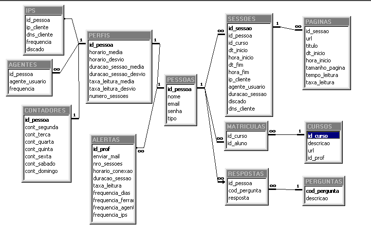

# Modelagem de dados

Modelos de bancos de dados são usados para descrever, mais detalhadamente, a estrutura do um banco de dados. Elas servem como parte importante da documentação do projeto.
Um modelo de dados não informa quais dados estão armazenados e sim quais e que tipos de dados o banco contém.

Esses modelos são baseados em três níveis: <u>Conceitual</u>, <u>Lógico</u> e <u>Físico</u>.

## Modelo conceitual

Modelo mais alto nível, ou seja, o mais próximo do usuário. É desenvolvido com alto nível de abstração, a partir dos requisitos do sistema. Podendo ser elaborado de forma textual ou por meio dos diagramas: Diagrama de Entidade e Relacionamento e/ou Diagrama de Classes¹.

¹*Diagramas UML - Unified Modeling Language (Linguagem de Modelagem Unificada)*

**Exemplo de modelo conceitual textual:**
- **Clientes**:
	- <u>Dados necessários</u>: nome completo, tipo de pessoa (física ou juridica), endereço, bairro, cidade, estado, telefone, email, nome de contato.
- **Pedido**:
	- <u>Dados necessários</u>: código do produto, quantidade, código do cliente, código do vendedor.

**Exemplo de modelo de entidade relacionamento (DER):**

