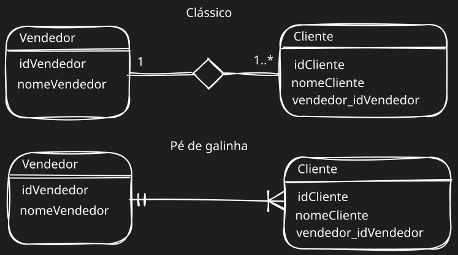

# Modelagem de dados

Modelos de bancos de dados são usados para descrever, mais detalhadamente, a estrutura do um banco de dados. Elas servem como parte importante da documentação do projeto.
Um modelo de dados não informa quais dados estão armazenados e sim quais e que tipos de dados o banco contém.

Esses modelos são baseados em três níveis: <u>Conceitual</u>, <u>Lógico</u> e <u>Físico</u>.
## Modelo conceitual

Modelo mais alto nível, ou seja, o mais próximo do usuário. É desenvolvido com alto nível de abstração, a partir dos requisitos do sistema. Representa os conceitos e relacionamentos essenciais em um domínio de negócios, sem se preocupar com detalhes de implementação, descrevendo de forma abstrata as entidades, seus atributos e os relacionamentos entre elas. Diagramas de Entidade-Relacionamento (ER) são frequentemente usados para representar o modelo conceitual.
## Modelo lógico

 O modelo lógico converte o modelo conceitual em uma representação mais próxima da implementação em um sistema de gerenciamento de banco de dados (SGBD). Foca em detalhes de implementação, como tabelas, colunas, chaves primárias e estrangeiras, índices, etc. Diagramas de Modelo Relacional são frequentemente usados para representar o modelo lógico em sistemas de banco de dados relacionais.
## Modelo físico

O modelo físico é a implementação concreta do modelo lógico em um SGBD específico. Considera detalhes de armazenamento, otimizações de desempenho, tipos de dados específicos do SGBD, índices físicos, etc. Usa comandos SQL específicas para a criação de tabelas, índices, restrições, entre outros, são utilizadas para definir o modelo físico.
## Outros conceito essenciais

- **Entidade**: é o objeto ou evento do mundo real sobre o qual desejamos manter registros em um banco de dados, podem ser nossas tabelas. Exemplos: Aluno, Carro, Produto, Vendedor, Venda, etc.
- **Atributo**: propriedades ou características que descrevem uma entidade, seriam as colunas/campos das tabelas. Exemplo: Para a entidade produto temos os atributos código, descrição e preço; para a entidade produto temos os atributos código e descrição.
- **Atributo chave**: também conhecido como chave primária, *primary key* ou *pk*, é um campo que possui valor único, ou seja, sem repetição, em todo o conjunto de dados da entidade. Ele é usado para identificar unicamente cada registro da tabela. Exemplos: Na entidade produtos temos o código do produto.
- **Relacionamentos**: normalmente as entidades estão associadas com outras entidades. Esses relacionamentos geram uma descrição muito mais rica ao modelo. Os relacionamentos podem acontecer entre uma, duas ou várias entidades. Exemplos: Uma entidade produto  tem uma relação com a entidade tipo de produto, pois um produto é um tipo de produto.
- **Chave estrangeira**: também conhecida como *foreign key* ou *fk*, é um atributo presente em uma entidade que indica um relacionamento e representa a chave primária de uma outra entidade. Exemplos: Uma entidade produto que tem uma relação com a entidade tipo de produto, possui um atributo que representa qual tipo de produto ele é.
- **Grau de relacionamento**: indica a quantidade de entidades ligadas a um relacionamento. Os principais graus de relacionamentos são o <u>unário</u>, <u>binário</u> e <u>ternário</u>.
	- **Unário**: chamado de grau 1, indica que uma entidade se ralaciona com ela mesma. Exemplos: Uma entidade funcionário que gerencia outro funcionário ou uma entidade pessoa que casa com outra pessoa.
	- **Binário**: chamado de grau 2, indica que uma entidade  se ralaciona com outra entidade, sendo o tipo mais comum de relacionamento. Exemplos: A entidade vendedor vende a entidade Produto ou a entidade Aluno cursa a entidade Disciplina.
	- **Ternário**: chamado de grau 3, indica que três entidades se relacionam por um mesmo relacionamento. Exemplo: A entidade Cliente faz um pedido a entidade Vendedor e realiza o pagamento desse pedido com a entidade Tipo de Pagamento.
- **Cardinalidade (Máxima)**: define a quantidade máxima de ocorrências de uma entidade que poderá estar associada a outra entidade. Exemplos: Um vendedor pode vender apenas um tipo de produto? Ou dois? Ou três? Um produto pode ser vendido por apenas um vendedor? Ou por todos?
	- **Um-Para-Um/One-to-One (1:1)**: indica que uma ocorrência da entidade A pode se relacionar exclusivamente com uma ocorrência da entidade B e vice versa. Exemplo: Um vendedor ocupa um único escritório e um escritório pode ser ocupado por um único vendedor.
	- **Um-Para-Muitos/One-to-Many (1:n)**: indica que uma ocorrência da entidade A pode se relacionar com várias ocorrências da entidade B, porém o inverso não é permitido. Exemplo: Um vendedor atende muitos clientes, porém cada cliente é atendido por apenas um vendedor específico.
	- **Muitos-Para-Muitos/Many-to-Many (n:m)**: indica que uma ocorrência da entidade A pode se relacionar com várias ocorrências da entidade B e vice versa. Exemplo: Um vendedor atende muitos clientes e um cliente pode ser atendido por diversos vendedores.
	  Na prática, o relacionamento n:m é dividido em duas relações 1:n, gerando assim uma nova entidade para representar esse relacionamento.
- **Cardinalidade (Mínima)**: define a quantidade mínima de ocorrências de uma entidade que precisa estar associada a outra entidade, em caráter obrigatório. São consideradas como cardinalidades mínimas: 0 e 1. Podem ser apresentadas por: 0..1, 1..1, 0..n, 1..n, 0..\*, 1..\*, etc. Exemplo: Um vendedor ocupa um único escritório, porém é obrigatório que ele tenha um escritório (lê-se no mínimo um e no máximo um) ou um escritório pode ser ocupado por um único vendedor, porém pode ser que a sala esteja vazia, ainda sem vendedor (lê-se no mínimo zero e no máximo um).
- **Formas de representação**: podemos encontrar uma variedade de representações gráficas para o modelo entidade relacionamento, sendo os mais comuns o *clássico* e o *pé de galinha*.

  
## Normalização de Dados

É o processo formal e passo a passo que examina o documento descritivo em busca de definir as entidades, atributos, relacionamentos, chaves primárias e chaves estrangeiras do banco de dados modelado. Esse processo utiliza regras bem estabalacidas conhecidas como <u>Formas Normais</u>. Seu principal objetivo é evitar ou pelo menos amenizar anomalias e inconsistências que podem ocorrer durante a inclusão, exclusão, alteração e consulta de registros em um banco de dados. Um banco de dados normalizado dentro dos padrões reduz o trabalho de manutenção e ajuda a evitar desperdício de espaço de armazenamento, dentre outros benefícios.
### Primeira Forma Normal (1FN)

Uma entidade estará na primeira forma normal se todos os campos forem atômicos (simples) e não multivalorados (com múltiplos valores).
Por exemplo, na tabela cliente:

| Código do cliente | Nome  | Telefone               | Endereço                          |
| :---------------- | :---- | :--------------------- | :-------------------------------- |
| C001              | José  | 9563-6352 9847-8596 | Rua Seis, 85, Morumbi, 12536-965  |
| C002              | Maria | 3265-8596              | Rua Onze, 64, Moema, 65985-693    |
| C003              | João  | 8548-8956 9598-6301 | Praça Ramos, Liberdade, 68858-633 |
O campo de telefone é multivalorados, pois temos mais de um telefone em um mesmo campo. Além disso, o campos endereço também é multivalorado porque possui valores diferentes no mesmo campo. Para corrigir esses casos podemos converter o campo endereço em três campos diferentes como rua, bairro e CEP; além de criar uma nova tabela para registrar os telefones:

| Código do cliente | Nome  | Rua          | Bairro    | CEP       |
| ----------------- | ----- | ------------ | --------- | --------- |
| C001              | José  | Rua Seis, 85 | Morumbi   | 12536-965 |
| C002              | Maria | Rua Onze, 64 | Moema     | 65985-693 |
| C003              | João  | Praça Ramos  | Liberdade | 68858-633 |

| Código do cliente | Telefone  |
| ----------------- | --------- |
| C001              | 9563-6352 |
| C001              | 9847-8596 |
| C002              | 3265-8596 |
| C003              | 8548-8956 |
| C003              | 9598-6301 |
### Segunda Forma Normal (2FN)