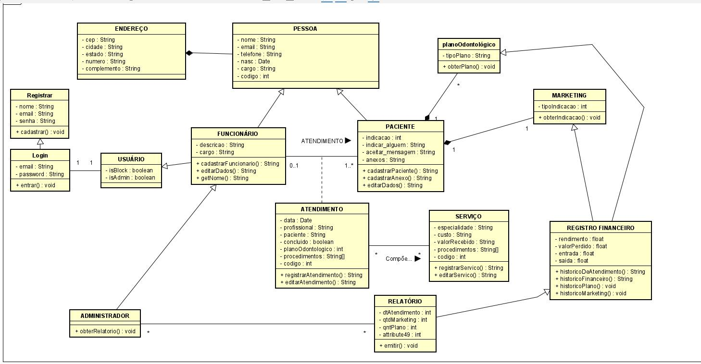
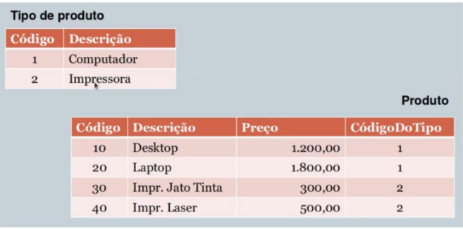

# Modelagem de dados

Modelos de bancos de dados são usados para descrever, mais detalhadamente, a estrutura do um banco de dados. Elas servem como parte importante da documentação do projeto.
Um modelo de dados não informa quais dados estão armazenados e sim quais e que tipos de dados o banco contém.

Esses modelos são baseados em três níveis: <u>Conceitual</u>, <u>Lógico</u> e <u>Físico</u>.
## Modelo conceitual

Modelo mais alto nível, ou seja, o mais próximo do usuário. É desenvolvido com alto nível de abstração, a partir dos requisitos do sistema. Podendo ser elaborado de forma textual ou por meio dos diagramas: Diagrama de Entidade e Relacionamento e/ou Diagrama de Classes¹.

¹*Diagramas UML - Unified Modeling Language (Linguagem de Modelagem Unificada)*
### Exemplos de modelo conceitual
#### Modelo conceitual textual
- **Clientes**:
	- <u>Dados necessários</u>: nome completo, tipo de pessoa (física ou juridica), endereço, bairro, cidade, estado, telefone, email, nome de contato.
- **Pedido**:
	- <u>Dados necessários</u>: código do produto, quantidade, código do cliente, código do vendedor.
#### Diagrama de entidade relacionamento (DER)

#### Diagrama de classes

## Modelo lógico

Descreve como os dados serão armazenados e seus relacionamentos, além de definir qual tecnologia vai ser usada para a armazenagem de dados.

Alguns exemplos de representações do modelo lógico:

## Modelo físico

Também pode ser chamado de modelo de implementação e descreve por meio de alguma linguagem (geralmente SQL) como será feita a armazenagem do banco. Neste nível, é definido qual SGBD será utilizado, levando em consideração o modelo lógico.
## Outros conceito essenciais

- **Entidade**: é o objeto ou evento do mundo real sobre o qual desejamos manter registros em um banco de dados, podem ser nossas tabelas. Exemplos: Aluno, Carro, Produto, Vendedor, Venda, etc.
- **Atributo**: propriedades ou características que descrevem uma entidade, seriam as colunas/campos das tabelas. Exemplo: Para a entidade produto temos os atributos código, descrição e preço; para a entidade produto temos os atributos código e descrição.
- **Atributo chave**: também conhecido como chave primária, *primary key* ou *pk*, é um campo que possui valor único, ou seja, sem repetição, em todo o conjunto de dados da entidade. Ele é usado para identificar unicamente cada registro da tabela. Exemplos: Na entidade produtos temos o código do produto.