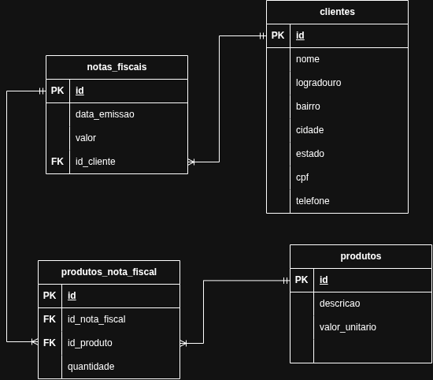
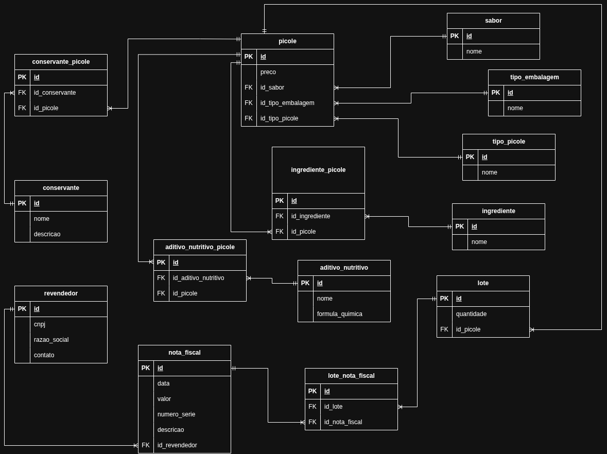

# Modelo Entidade Relacionamento (MER)

Abaixo temos um exemplo de uam modelagem para o fluxo de emissão de nota fiscal:

Algumas conclusões importantes que podemos tirar do diagrama:

- Temos as entidades Nota Fiscal, Cliente, Produto e Produto da Nota Fiscal;
- A entidade Produto da Nota Fiscal tem relação com as entidades Nota Fiscal e Produto, criando um vínculo entre essas duas entidades;
- Um Produto da Nota Fiscal pode conter um único Produto e só pode estar em uma única Nota Fiscal;
- Já um Produto pode estar em múltiplos Produtos da Nota Fiscal e uma Nota Fiscal pode conter múltiplos produtos;
- Por fim, uma nota fiscal precisa ter um cliente e só pode conter um único cliente, porém o Cliente pode possuir múltiplas Notas Fiscais.

#### Exercício de Modelagem de Dados

Uma empresa fabricante de picolés deseja armazenar informações acerca deseusnegócios.Ospicolés fabricados são divididos em normal (com água) e ao leite. As informaçõescomunsarmazenadas dos picolés são: sabor, ingredientes, preço e tipo da embalagem. Especificamente,picolés normais possuem um conjunto de aditivos nutritivos (vitaminas ou sais minerais)cadaum com nome e fórmula química; e picolés ao leite contêm um conjunto de conservantes,cadaum com nome e descrição. Os dois tipos de picolés são vendidos emlotes exclusivos(ounormais,ou ao leite) para os revendedores e cada venda gera uma nota fiscal que podeconterumouvários lotes. As notas fiscais possuem data, valor, número de série e descrição. Todorevendedorpossui uma pessoa de contato para eventuais resoluções de problemas, alémdisso, armazena-sedo revendedor o CNPJ e a razão social. Deseja-se obter relatórios sobre as vendasmensaisdospicolés de cada tipo e quais revendedores compraram mais picolés nos últimos meses.

