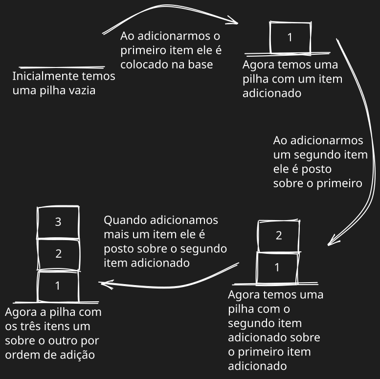
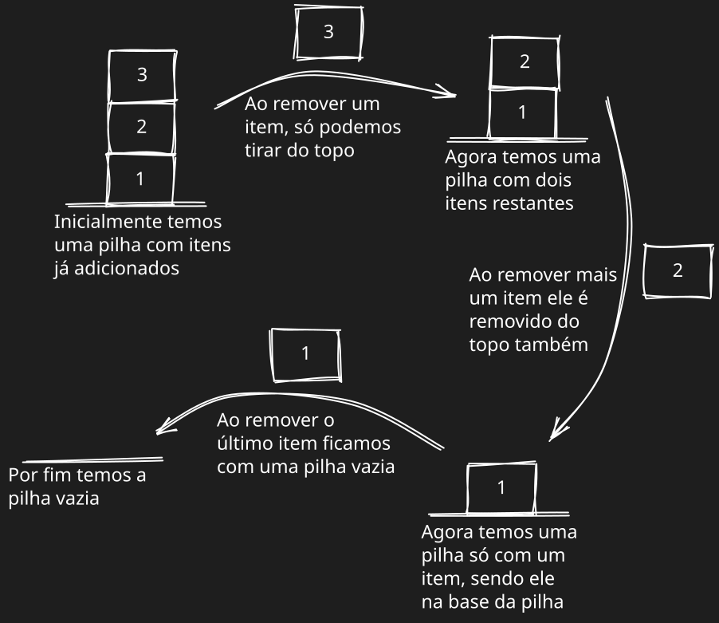
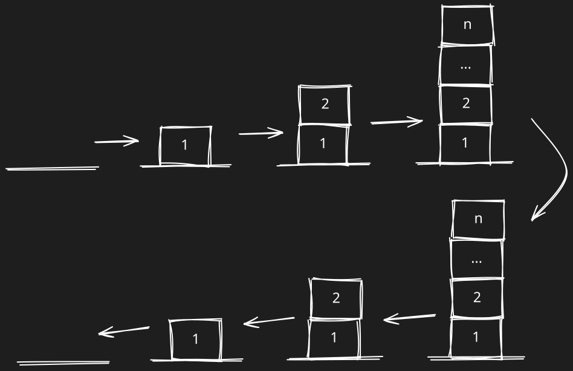

# Stack (pilha)

Pilhas seguem o princípio **LIFO** (Last In First Out), ou seja, o último a entrar é o primeiro a sair.



Sempre que adicionamos um elemento na pilha ele é posicionado sobre o último elemento adicionado, caso a pilha não esteja vazia. Para uma pilha vazia, o primeiro elemento é adicionado na base.  Não podemos adicionar um elemento no meio ou no início da pilha, sempre no topo.



Ao remover um item da pilha, só conseguimos remover o elemento do topo, não podemos remover elementos de outra posição dentro da pilha.



Exemplo de implementação usando JavaScript:
```js
export class Stack {
  #count;
  #items;

  constructor() {
    this.#count = 0;
    this.#items = {};
  }

  push(element) {
    this.#items[this.#count] = element;
    this.#count++;
  }

  peek() {
    if (this.isEmpty()) return;
    return this.#items[this.#count - 1];
  }

  pop() {
    if (this.isEmpty()) return;
    this.#count--;
    const result = this.#items[this.#count];
    delete this.#items[this.#count];
    return result;
  }

  isEmpty() {
    return this.#count === 0;
  }

  size() {
    return this.#count;
  }

  clear() {
    this.#count = 0;
    this.#items = {};
  }

  toString() {
    if (this.isEmpty()) return "[]";
    return "[" + Object.values(this.#items).join(", ") + "]";
  }
}
```

