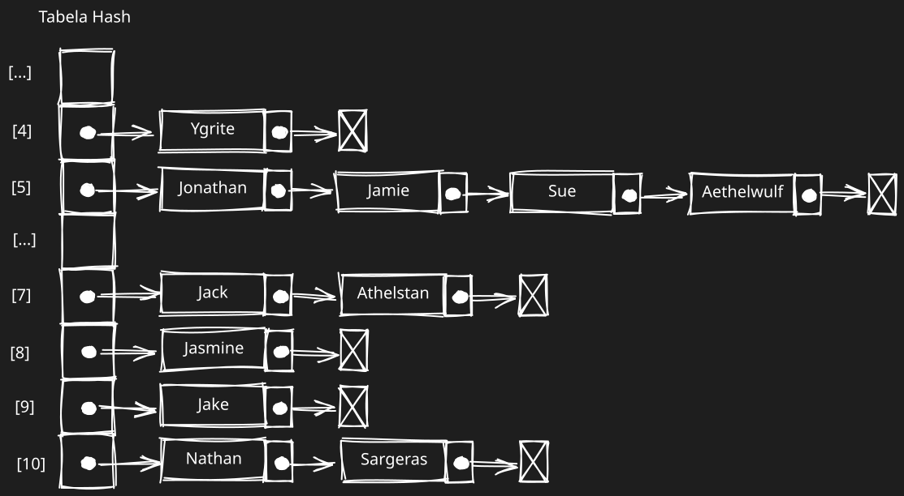
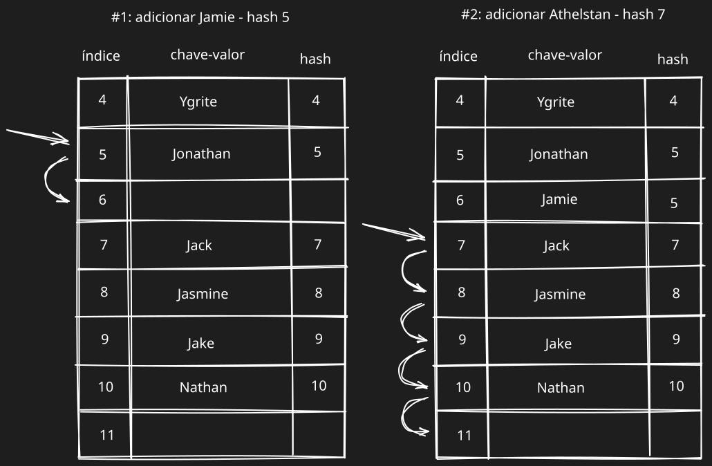

# HashTable (tabela hash)

Uma tabela hash é uma impementação dos dicionários que usa hash. O hashing é uma metodologia para se encontrar um valor dentro de uma estrutura de dados o mais rápido possível. Para encontramos um valor em outras estruturas de dados é necessário iterar através dos elementos até que o valor seja encontrado. Quando se usa a função hash, a posição do valor já é conhecido, então podemos simplismente acessa-lo. Uma função hash é uma função que, dada uma chave, retorna o endereço em que o valor está na tabela.
Exemplo de implementação usando JavaScript:
```js
export function defaultToString(item) {
  if (item === null) {
    return "NULL";
  } else if (item === undefined) {
    return "UNDEFINED";
  } else if (typeof item === "string" || item instanceof String) {
    return `${item}`;
  }

  return item.toString();
}

class ValuePair {
  #key;
  #value;

  get key() {
    return this.#key;
  }

  get value() {
    return this.#value;
  }

  constructor(key, value) {
    this.#key = key;
    this.#value = value;
  }

  toString() {
    return `[#${this.#key}: ${this.#value}]`;
  }
}

export default class HashTable {
  #toStringFn;
  #table;

  constructor(toStringFn = defaultToString) {
    this.#toStringFn = toStringFn;
    this.#table = {};
  }

  #loseloseHashCode(key) {
    if (typeof key === "number") {
      return key;
    }

    const tableyKey = this.#toStringFn(key);
    let hash = 0;
    for (let i = 0; i < tableyKey.length; i++) {
      hash += tableyKey.charCodeAt(i);
    }
    
    return hash % 37;
  }

  hashCode(key) {
    return this.#loseloseHashCode(key);
  }

  put(key, value) {
    if (
      key !== null &&
      key !== undefined &&
      value !== null &&
      value !== undefined
    ) {
      const position = this.hashCode(key);
      this.#table[position] = new ValuePair(key, value);
      return true;
    }

    return false;
  }

  get(key) {
    const valuePair = this.#table[this.hashCode(key)];
    return valuePair === null || valuePair === undefined
      ? undefined
      : valuePair.value;
  }

  remove(key) {
    const hash = this.hashCode(key);
    const valuePair = this.#table[hash];
    if (valuePair !== null && valuePair !== undefined) {
      delete this.#table[hash];
      return true;
    }

    return false;
  }

  size() {
    return Object.keys(this.#table).length;
  }

  isEmpty() {
    return this.size() === 0;
  }

  clear() {
    this.#table = {};
  }

  toString() {
    if (this.isEmpty()) return "[]";
    return `[${Object.entries(this.#table)
      .map(
        ([key, valuePair]) =>
          `{${key} => [#${valuePair.key}: ${valuePair.value}]}`,
      )
      .join(", ")}]`;
  }
}
```

Pode acontecer que diferentes chaves gerarem o mesmo valor de hash, esse comportamento é chamado de colisão, pois multiplos valores estariam sendo atribuídos a mesma posição. Existem algumas formas de resolver isso, como o encadeamento separado (separate chaining), sondagem linear (linear probing) e hashing duplo (double hashing).

### Encadeamente separado (separate chaining)

Consiste em criar uma lista ligada para cada posição da tabela e armazenar aí os elementos. É a técnica mais simples que há para tratar colisões; no entanto, ela exige memória extra, além daquela ocupada pela instância de HashTable.



Exemplo de implementação usando JavaScript:
```js
export function defaultToString(item) {
  if (item === null) {
    return "NULL";
  } else if (item === undefined) {
    return "UNDEFINED";
  } else if (typeof item === "string" || item instanceof String) {
    return `${item}`;
  }

  return item.toString();
}

class ValuePair {
  #key;
  #value;

  get key() {
    return this.#key;
  }

  get value() {
    return this.#value;
  }

  constructor(key, value) {
    this.#key = key;
    this.#value = value;
  }

  toString() {
    return `[#${this.#key}: ${this.#value}]`;
  }
}

export default class HashTableSeparateChaining {
  #toStringFn;
  #table;

  constructor(toStringFn = defaultToString) {
    this.#toStringFn = toStringFn;
    this.#table = {};
  }

  #loseloseHashCode(key) {
    if (typeof key === "number") {
      return key;
    }
    const tableyKey = this.#toStringFn(key);
    let hash = 0;
    for (let i = 0; i < tableyKey.length; i++) {
      hash += tableyKey.charCodeAt(i);
    }
    return hash % 37;
  }

  hashCode(key) {
    return this.#loseloseHashCode(key);
  }

  put(key, value) {
    if (
      key !== null &&
      key !== undefined &&
      value !== null &&
      value !== undefined
    ) {
      const position = this.hashCode(key);
      if (this.#table[position] == null) {
        this.#table[position] = new LinkedList();
      }
      this.#table[position].push(new ValuePair(key, value));
      return true;
    }
    return false;
  }

  get(key) {
    const position = this.hashCode(key);
    const linkedList = this.#table[position];
    if (linkedList != null && !linkedList.isEmpty()) {
      let current = linkedList.getHead();
      while (current !== null) {
        if (current.getElement().key === key) {
          return current.getElement().value;
        }
        current = current.next;
      }
    }
    return undefined;
  }

  remove(key) {
    const position = this.hashCode(key);
    const linkedList = this.#table[position];
    if (linkedList != null && !linkedList.isEmpty()) {
      let current = linkedList.getHead();
      while (current !== null) {
        if (current.getElement().key === key) {
          linkedList.remove(current.getElement());
          if (linkedList.isEmpty()) {
            delete this.#table[position];
          }
          return true;
        }
        current = current.next;
      }
    }
    return false;
  }

  size() {
    return Object.keys(this.#table).length;
  }

  isEmpty() {
    return this.size() === 0;
  }

  clear() {
    this.#table = {};
  }

  toString() {
    if (this.isEmpty()) return "[]";
    return `[\n${Object.entries(this.#table)
      .map(([key, valuePair]) => `\t{${key} => ${valuePair}}`)
      .join(", \n")}\n]`;
  }
}
```

### Sondagem linear (linear probing)

Essa abordagem é chamada de linear porque a colisão é resolvida de forma que os valores serão armazenados diretamente na tabela, e não em uma estrutura diferente. Ao tentar adicionar um novo elemento, se a position do hash já estiver ocupada, tentaremos usar position + 1. Se position + 1 estiver ocupada, tentaremos position + 2, e assim sucessivamente, até que uma
posição livre seja encontrada na tabela hash. Vamos supor que temos uma tabela hash com alguns valores já inseridos, e queremos adicionar uma nova chave e um novo valor. Calculamos o hash para essa nova chave e verificamos se a position do hash já está ocupada. Se não estiver, adicionamos o valor na posição correta. Se estiver ocupada, iteramos pelo hash até encontrarmos uma posição livre.



Exemplo de implementação usando JavaScript:
```js
export function defaultToString(item) {
  if (item === null) {
    return "NULL";
  } else if (item === undefined) {
    return "UNDEFINED";
  } else if (typeof item === "string" || item instanceof String) {
    return `${item}`;
  }

  return item.toString();
}

class ValuePair {
  #key;
  #value;

  get key() {
    return this.#key;
  }

  get value() {
    return this.#value;
  }

  constructor(key, value) {
    this.#key = key;
    this.#value = value;
  }

  toString() {
    return `[#${this.#key}: ${this.#value}]`;
  }
}

export default class HashTableLinearProbing {
  #toStringFn;
  #table;

  constructor(toStringFn = defaultToString) {
    this.#toStringFn = toStringFn;
    this.#table = {};
  }

  #loseloseHashCode(key) {
    if (typeof key === "number") {
      return key;
    }
    const tableyKey = this.#toStringFn(key);
    let hash = 0;
    for (let i = 0; i < tableyKey.length; i++) {
      hash += tableyKey.charCodeAt(i);
    }
    return hash % 37;
  }

  hashCode(key) {
    return this.#loseloseHashCode(key);
  }

  put(key, value) {
    if (
      key !== null &&
      key !== undefined &&
      value !== null &&
      value !== undefined
    ) {
      const position = this.hashCode(key);

      if (this.#table[position] === null) {
        this.#table[position] = new ValuePair(key, value);
      } else {
        let index = position + 1;
        while (this.#table[index] != null) {
          index++;
        }
        this.#table[index] = new ValuePair(key, value);
      }
      return true;
    }
    return false;
  }

  get(key) {
    const position = this.hashCode(key);
    if (this.#table[position] != null) {
      if (this.#table[position].key === key) {
        return this.#table[position].value;
      }
      let index = position + 1;
      while (this.#table[index] != null && this.#table[index].key !== key) {
        index++;
      }
      if (this.#table[index] != null && this.#table[index].key === key) {
        return this.#table[position].value;
      }
    }
    return undefined;
  }

  #verifyRemoveSideEffect(key, removedPosition) {
    const hash = this.hashCode(key);
    let index = removedPosition + 1;
    while (this.#table[index] != null) {
      const posHash = this.hashCode(this.#table[index].key);
      if (posHash <= hash || posHash <= removedPosition) {
        this.#table[removedPosition] = this.#table[index];
        delete this.#table[index];
        removedPosition = index;
      }
      index++;
    }
  }

  remove(key) {
    const position = this.hashCode(key);
    if (this.#table[position] != null) {
      if (this.#table[position].key === key) {
        delete this.#table[position];
        this.#verifyRemoveSideEffect(key, position);
        return true;
      }
      let index = position + 1;
      while (this.#table[index] != null && this.#table[index].key !== key) {
        index++;
      }
      if (this.#table[index] != null && this.#table[index].key === key) {
        delete this.#table[index];
        this.#verifyRemoveSideEffect(key, index);
        return true;
      }
    }
    return false;
  }

  size() {
    return Object.keys(this.#table).length;
  }

  isEmpty() {
    return this.size() === 0;
  }

  clear() {
    this.#table = {};
  }

  toString() {
    if (this.isEmpty()) return "[]";
    return `[\n${Object.entries(this.#table)
      .map(([key, valuePair]) => `\t{${key} => ${valuePair}}`)
      .join(", \n")}\n]`;
  }
}
```

### Outras funções de hash
```js
djb2HashCode(key) {
	const tableKey = this.#toStringFn(key);
	let hash = 5381;
	for (let i = 0; i < tableKey.length; i++) {
		hash = (hash * 33) + tableKey.charCodeAt(i);
	}
	
	return hash % 1013;
}
```