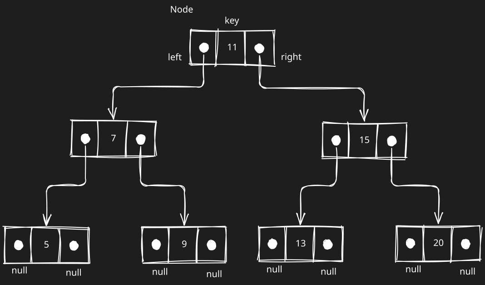
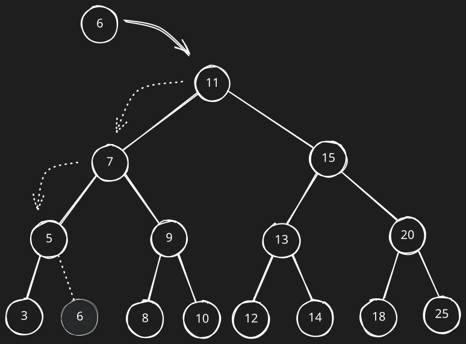
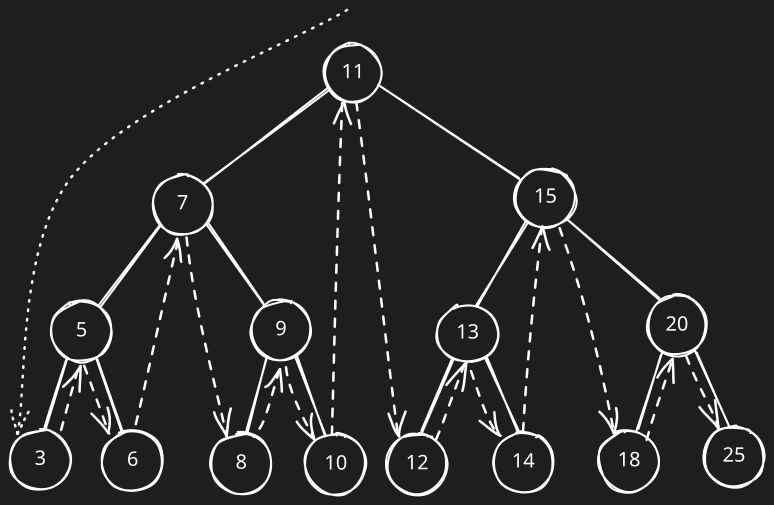

# Tree (árvore)

Uma árvore é um modelo abstrato de uma estrutua hierárquica. Um exemplo de uso dessa estrutura são as árvores genealógica ou um organograma de uma empresa.

Uma árvore é composta de nós (ou nodos) em um relacionamento pai-filho. Todo nó tem um pai, exceto o primeiro nó no topo, e zero ou mais filhos. O nó do topo é chamado de raiz. A árvore possui nós internos e externos. Um nó interno possui pelo menos um filho. O nó externo, também conhecido como folha, é um nós sem filhos.

Um nó pode ter ancestrais e descendentes. Os nós ancestrais são o pai, avô, bisavô e assim por diante. Já os descendentes são os filhos, netos, bisnetos e assim sucessivamente.

Uma árvore pode ser compostas por subárvores, que é definida por um nó e seus descendentes.

A profundidade de um nó corresponde ao número de ancestrais daquele nó. Com base nisso, a altura de uma árvore pode ser definida pela maior profundidade entre os nós da árvore.

Por fim, uma árvore pode ser dividida em níveis, sendo que o nó raiz está no nível 0, seus filhos no nível 1, assim sucessivamente.

### Árvore binária

Uma árvore binária é composta por nós que possuem no máximo dois filhos: um à esquerda e outro à direita.

Uma árvore binária de busca ou Binary Search Tree (BST) é uma árvore binária que só permite armazenar valores menores do lado esquerdo e valores maiores no lado direito. 

O fluxo de adição de um elemento em uma BST é:

Para percorrer uma árvore existem algumas estratégias, dentre elas temos: 
- em-ordem (in-order), que visita todos os nós de uma BST em ordem crescente;
- pré-ordem (pre-order);
- pós-ordem (post-order).

O fluxo do em-ordem é ilustrado por:
